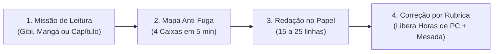

# Projeto "Leitura em Ação": Metodologia, Modelo de Redação e Economia de Recompensas

> [!IMPORTANT]
> **O Grande Segredo Pedagógico (TEA 2 + Fuga ao Tema + Provas do 6º Ano)**
> Se pedirmos apenas *"leia esse mangá e escreva uma redação sobre ele"*, duas coisas acontecem com alunos com TEA 2 e TDAH:
> 1. **Resumo caótico:** Ele lista cenas soltas (*"Daí o personagem bateu no outro, daí explodiu..."*) sem começo, meio e fim;
> 2. **Fuga ao tema por associação:** Um detalhe do mangá lembra outra coisa que ele gosta, e ele passa o resto da folha falando disso.
>
> Além disso, as provas do **6º ano (CMRJ, CP2, CAp UERJ)** não pedem resumos livres: elas cobram **Narrativas** (ou cartas/contos) obedecendo a um **tema/comando específico**. Por isso, a leitura será o **combustível**, mas a redação terá sempre uma **Missão com Âncora**.

---

## 1. O Fluxo em 3 Etapas (Da Leitura ao Papel)

Para competir com o cérebro acostumado a vídeos curtos e jogos, o processo não pode parecer um "dever eterno". Ele é dividido em **3 micro-etapas visuais**:



### Etapa 1: A Leitura (A Escolha Dele)
Ele pode escolher o que ler, mas o "peso" da leitura muda a recompensa base:
- **Nível Bronze (Rápido):** 1 Gibi (Turma da Mônica, etc.) ou 1 capítulo curto de Mangá.
- **Nível Prata (Médio):** 2 a 3 capítulos de Mangá ou 1 capítulo de livro infantojuvenil (ex.: *Diário de um Banana*, *Percy Jackson*, crônicas).
- **Nível Ouro (Desafio de Prova):** 1 conto/crônica selecionado por você (textos no estilo das provas do CMRJ/CP2) ou capítulo de livro sem imagens.

---

### Etapa 2: O "Mapa Anti-Fuga" (Obrigatório antes de escrever)

Alunos no espectro (TEA 2) costumam fugir do tema porque a **memória de trabalho sobrecarrega** ao tentar pensar na letra, na ortografia e na história ao mesmo tempo. 

Antes de pegar a folha de redação definitva, ele preenche uma **Ficha de Planejamento de 4 Caixas** (leva 5 minutos):

| Caixa | O que ele preenche (máximo 1 frase por caixa) | Função Cognitiva (TEA 2) |
| :--- | :--- | :--- |
| **🎯 A ÂNCORA (Tema)** | Qual é a missão do texto? + **3 Palavras-Chave Obrigatórias** que precisam aparecer no texto. | Impede a fuga ao tema. Se não tem a ver com a Âncora, não entra no texto. |
| **🟢 1. COMEÇO (Parágrafo 1)** | **Quem** é o personagem principal, **onde** ele está e **o que estava acontecendo** normalmente? *(3 a 5 linhas)* | Ensina a contextualizar o leitor (não começar a história pelo meio). |
| **🟡 2. MEIO / PROBLEMA (Parágrafos 2 e 3)** | **Qual problema surgiu** (conflito) e **qual foi o momento mais difícil/importante** (clímax)? *(8 a 12 linhas)* | Garante que a história tenha enredo e desenvolvimento (não seja só descrição). |
| **🔵 3. FIM (Parágrafo 4)** | **Como o problema foi resolvido** e **qual foi o aprendizado/consequência** ligada à Âncora? *(3 a 5 linhas)* | Evita finais abruptos (*"e aí acabou"*, *"e ele acordou"*). |

> [!TIP]
> **Técnica das 3 Palavras-Chave Sublinhadas:**
> Antes de ele começar a escrever, vocês combinam **3 palavras ligadas ao tema** (ex.: se o capítulo do mangá foi sobre *não desistir de proteger um amigo*, as palavras podem ser `promessa`, `dificuldade` e `amizade`). Ele tem a missão de usar e **sublinhar** essas 3 palavras ao longo da redação. Isso mantém o cérebro dele ancorado no tema do início ao fim.

---

### Etapa 3: Os 3 Tipos de "Missão de Redação" (Progressão até o Concurso)

Você não precisa cobrar o nível mais difícil logo na primeira semana. Vocês podem subir de fase conforme ele melhorar:

1. **Fase 1 — O Repórter da História (Para destravar a escrita e a estrutura)**
   - **Comando:** *"Conte a história desse capítulo para alguém que nunca leu esse mangá/livro, destacando o problema que o personagem enfrentou e como ele resolveu."*
   - **Regra:** Proibido usar gírias de internet; precisa explicar quem é o personagem no 1º parágrafo.
2. **Fase 2 — Mudança de Câmera / Carta (Muito cobrado em CP2 e CAp UERJ)**
   - **Comando:** *"Reescreva o acontecimento principal do capítulo como se você fosse o personagem [X] contando o que sentiu (1ª pessoa) OU escreva uma carta do personagem [X] para [Y] explicando por que tomou aquela atitude."*
3. **Fase 3 — Ponte para a Prova (Padrão CMRJ / CP2 6º Ano)**
   - **Comando:** Você pega a **lição moral/tema** do capítulo que ele leu (ex.: *trabalho em equipe*, *coragem*, *um mal-entendido*, *superar um medo*) e pede: *"Crie uma história original (com outros personagens ou na escola) em que alguém passa por um problema parecido com esse e aprende a mesma lição."*

---

## 2. Rubrica de Correção (Simples, Visual e Sem Subjetividade)

Crianças com TEA 2 lidam muito mal com avaliações vagas como *"ficou ruim"* ou *"está confuso"*. A nota precisa funcionar como o **placar de um jogo (0 a 100 pontos / 5 critérios de 20 pontos)**, onde ele sabe exatamente onde ganhou e onde perdeu pontos:

| Critério | Vale | 0 pts (Precisa refazer) | 10 pts (Parcial) | 20 pts (Missão Completa) |
| :--- | :---: | :--- | :--- | :--- |
| **1. Foco na Missão (Não fugiu do tema)** | **20 pts** | Fugiu totalmente do assunto ou falou de outra coisa. | Começou no tema, mas desviou no meio da história. | Manteve o tema do início ao fim e usou as **3 palavras-chave**. |
| **2. Estrutura (Começo, Meio e Fim)** | **20 pts** | Escreveu tudo num bloco só ou parou a história no meio. | Dividiu em parágrafos, mas o final foi corrido/sem desfecho. | 3 a 4 parágrafos claros seguidos do Mapa (Começo, Conflito, Clímax e Fim). |
| **3. Mínimo de Linhas e Letra Legível** | **20 pts** | Menos de 12 linhas ou letra impossível de ler. | Entre 12 e 15 linhas, ou muitas rasuras. | **15 a 25 linhas** (padrão 6º ano), margem respeitada e letra legível. |
| **4. Clareza (Quem lê entende a história)** | **20 pts** | Frases soltas sem conexão (*"daí... daí... daí..."*). | Dá para entender, mas repete muitas palavras. | Usou conectivos (*então, porém, por isso, no final*) e explicou bem a cena. |
| **5. Capricho no Português** | **20 pts** | Sem pontuação (tudo numa frase só) e sem maiúsculas. | Usa ponto final, mas esquece maiúsculas ou muitos erros básicos. | Pontuação correta, letra maiúscula no início das frases e revisão feita. |

> [!WARNING]
> **Regra da "Segunda Chance" (Essencial para não gerar frustração):**
> Se ele tirar menos de 60 pontos (ex.: fugiu do tema no 3º parágrafo ou esqueceu de pontuar), ele **não perde tudo**: você circula apenas o trecho que precisa consertar e ele pode **reescrever aquele parágrafo** para recuperar os pontos na hora.

---

## 3. Economia Integrada: Horas de PC + Mesada do Tio

Para que o sistema funcione sem brigas e sem que ele "trapaceie" fazendo redações de qualquer jeito só para acumular horas, a melhor estratégia é:
- **Horas de PC (Fim de Semana)** = Recompensa por **Produção e Qualidade das Redações** durante a semana.
- **Mesada (R\$)** = Recompensa por **Consistência Semanal (Meta Batida) + Bônus de Excelência**.

### A. Como ele ganha Horas de PC para o Fim de Semana

Em vez de ganhar uma hora fixa mesmo se escrever mal, **a nota da redação define quantos minutos ele destrava**:

1. **Teto Semanal Saudável:** Defina um limite máximo no fim de semana (ex.: **máximo de 6 horas no FDS inteiro** — 3h no sábado e 3h no domingo) para não alimentar o vício.
2. **Tabela de Conversão (Por Conjunto: 1 Leitura + 1 Mapa + 1 Redação):**
   - **Nota 80 a 100 pts (Ouro):** Destrava **90 minutos (1h30)** de PC.
   - **Nota 60 a 70 pts (Prata):** Destrava **60 minutos (1h)** de PC.
   - **Nota 40 a 50 pts (Bronze):** Destrava **30 minutos** de PC (mas pode reescrever o trecho fraco para subir para Prata/Ouro!).
   - **Abaixo de 40 pts (ou Fuga Total ao Tema):** Precisa ajustar com sua ajuda antes de destravar o tempo.
   - **Bônus Leitura Desafio (+15 min):** Se a leitura foi do **Nível Ouro** (livro sem figuras ou texto de prova), ganha +15 minutos extras.

*Exemplo prático:* Se a meta da semana são **3 redações** (ex.: terça, quinta e sexta), fazendo 3 redações boas (Prata/Ouro) ele destrava entre **3h e 5h de PC** para o fim de semana!

---

### B. Como integrar a Mesada do Tio (Sem confundir com as Horas de PC)

Se ele tiver que "gastar" horas de PC para ter dinheiro (ou vice-versa), ele sempre vai escolher o PC por causa do vício em jogos. Por isso, **a Mesada usa os mesmos pontos da semana, mas premia a Consistência e a Disciplina**:

| Faixa da Mesada Semanal | Condição para Destravar | Exemplo de Valor (Ajustável pelo Tio) |
| :--- | :--- | :--- |
| **Mesada Base (50%)** | Fez as obrigações básicas da casa/escola + Kumon em dia + **respeitou o horário de desligar o PC sem briga**. | Ex.: R\$ 15,00 / semana |
| **Meta de Redação Batida (+30%)** | Entregou as **3 Leituras + 3 Redações da semana** com nota mínima de 60 pts. | + R\$ 10,00 / semana |
| **Bônus "Nota de Concurso" (+20%)** | Pelo menos **1 redação na semana tirou 90+ pontos** (letra caprichada, sem fugir do tema, 15+ linhas). | + R\$ 5,00 / semana |
| **Total Semanal Possível** | Combo Completo (Deveres + 3 Redações + 1 Excelente) | **Ex.: R\$ 30,00 / semana** |

> [!CAUTION]
> **Penalidade Clara de Comportamento no PC ("Multa de Tempo"):**
> Como ele tem vício em jogos/vídeos curtos, o momento de **desligar o computador** costuma ser crítico em jovens com TEA 2. 
> - **Combinado prévio e visual:** Usar um despertador/timer visível (aviso faltando 15 min e 5 min).
> - Se desligar no horário combinado sem crise: ganha um **Bônus de Pontualidade (+15 min no dia seguinte)**.
> - Se passar do tempo ou recusar desligar: o tempo excedido é descontado em dobro do próximo dia.

---

## 4. Folha-Modelo de Missão (Pronta para Imprimir ou Usar no Caderno)

Quando ele for fazer a atividade no papel, ele segue exatamente este roteiro de 1 página:

```text
======================================================================
MISSÃO DE LEITURA E REDAÇÃO #____                 DATA: ___/___/2026
======================================================================
1. O QUE EU LI HOJE: _________________________________________________
   [ ] Gibi/Mangá (1 cap)   [ ] Mangá (2-3 caps) / Livro   [ ] Texto Desafio

2. MAPA ANTI-FUGA (Preencha antes de escrever a redação!)
   🎯 MISSÃO / TEMA CENTRAL: _________________________________________
   🔑 3 PALAVRAS OBRIGATÓRIAS (sublinhar no texto):
      1) _________________  2) _________________  3) _________________

   🟢 PARÁGRAFO 1 (Começo - Quem? Onde? Quando?):
      ________________________________________________________________
   🟡 PARÁGRAFOS 2 e 3 (Meio - Qual foi o problema e o momento principal?):
      ________________________________________________________________
   🔵 PARÁGRAFO 4 (Fim - Como resolveu e o que aprendeu?):
      ________________________________________________________________

----------------------------------------------------------------------
3. MINHA REDAÇÃO (Mínimo: 15 linhas | Máximo: 25 linhas)
   Título: ___________________________________________________________
   01 ________________________________________________________________
   02 ________________________________________________________________
   ...
   15 ________________________________________________________________
   (Meta mínima atingida! Continue até concluir o Parágrafo 4)
   ...
   25 ________________________________________________________________
----------------------------------------------------------------------
4. PLACAR DO CORRETOR:
   [  /20] Foco no Tema + 3 Palavras   [  /20] Estrutura (Começo/Meio/Fim)
   [  /20] Linhas (15+) e Caligrafia   [  /20] Clareza e Conectivos
   [  /20] Pontuação e Português       TOTAL: [    / 100 PONTOS ]

   ⏱️ HORAS DE PC DESTRAVADAS: ______ min   |   💰 META DA MESADA: [ ] OK
======================================================================
```
